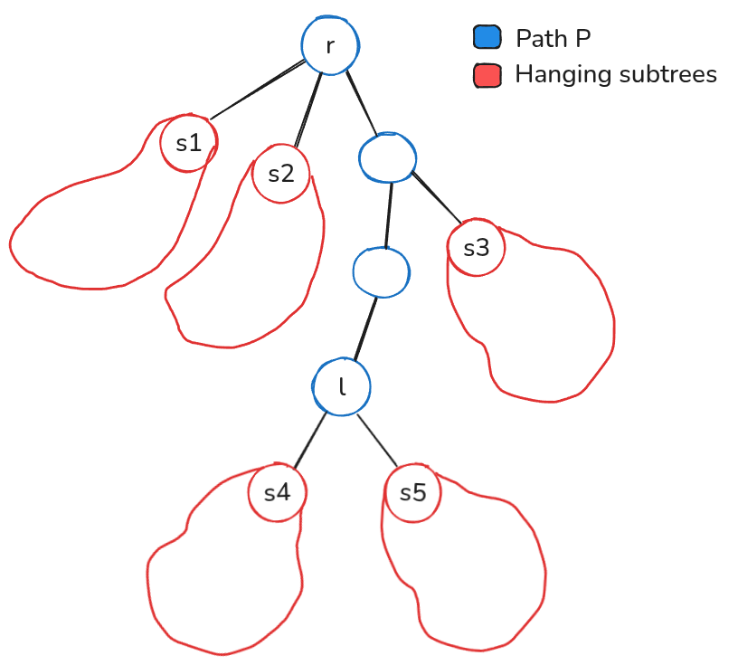

Prerequisite: [DFS-Trees](https://codeforces.com/blog/entry/68138)

Consider the following problem:

> Given a graph $G(V, E)$ on $n$ nodes, find a simple path with at least $n/2$ nodes in either $G$ or its complement $G'$.

Let's ask ourselves a dumb question: Given some simple path $P$ in $G$, can we find a simple path $P'$ in $G'$ that contains every node that's not in $P$?

If this was possible for *any* path $P$, then at least one of $P$ or $P'$ would satisfy our requirements, as $\max(\vert P \vert, \vert P' \vert) = \max(\vert P \vert, n - \vert P \vert)\geq n/2$. 

There can of course be exponentially many paths $P$ in $G$, so we restrict our analysis to a convenient subset of paths. Let's construct some "DFS-Forest" $F$ of $G$ (a DFS-Tree for every connected component). In fact, let's simplify our analysis even further for the moment, and assume that $G$ is connected, so it yields just one DFS-Tree.

Now, consider paths $P$ from the root $r$ to some node $l$. This simple path clearly exists in $G$, but what about $P'$? Can we somehow chain together nodes that don't lie in $P$ into a simple path?

  

The DFS-Tree, along with $P$ can be visualised in the above manner. Can we think of some connection between DFS-trees and complement graphs that would allow us to chain together the red nodes to construct $P'$?

If you've read the blog I've linked at the top, the following observation will seem fairly natural:

#### Lemma 1

> Neither $u$ nor $v$ is an ancestor of the other in $F$ $\implies$ edge $(u, v)$ exists in $G'$.

Now consider the subtrees $s_1, s_2, \dots s_k$ hanging off $P$. The above observation implies that there's an edge in $G'$ between every pair of nodes that belong to different subtrees!

Therefore, *one* (of possibly many) way to construct a path in $G'$ that visits every node in $S = s_1 \cup s_2 \cup \dots \cup s_k$ could be to start at some node outside $P$, and then repeatedly jump to a previously unvisited node that lies in a different hanging subtree from the current one.

What condition on $s_1, s_2, \dots s_k$ will allow us to always construct $P'$ in such a manner? We just want $\max(\vert s_i \vert) \leq \lceil \frac{\vert S \vert}{2} \rceil $!

Proof

Necessary and sufficient condition for rearranging a string such that no two adjacent characters are equal.

But wait a minute, does there always exist a $P$ such that the induced $s_1, s_2, \dots s_k$ satisfy this property? 

#### Lemma 2

> For any rooted tree, we can always find a path $P$ starting at the root such that the induced $s_1, s_2, \dots s_k$ satisfy $\max(\vert s_i \vert) \leq \lceil \frac{\vert S \vert}{2} \rceil $.

Proof

Denote the path between $r$ and $l$ by $P$, and $S = V \setminus P$.

Let's start at the root, with $l = r$. If this path satisfies the required condition, then we're done. But what if it doesn't? This would mean that exactly one child $c$ of $l$ has a subtree of size $> \lceil \frac{\vert S \vert}{2} \rceil $. 

Clearly, any valid $l$ must lie in the subtree of $c$, as any other choice would result in the hanging subtree of $c$ having  $> \lceil \frac{\vert S \vert}{2} \rceil $ nodes. We then set $l = c$ and recursively continue ($P$ and $S$ are updated). At every step, if there's some child of $l$ with subtree-size $> \lceil \frac{\vert S \vert}{2} \rceil $, we're forced to place $l$ somewhere in its subtree. Since we'll eventually hit a leaf (which has no children), we're guaranteed to reach a node $l$ where there's no "dominant" child. Note that whenever we're at a node with a dominant child, no induced hanging subtree outside the subtree of the current node can be dominant.

When we reach such a node $l$, can there be some dominant $s_i$ induced outside $l$'s subtree? Let $p$ be the parent of $l$, and $x$ be the subtree size of $l$. Since $p$ doesn't satisfy the condition, we must have $x > \lceil \frac{(\vert S \vert + 1)}{2} \rceil $. This implies that the maximum possible size of any hanging-subtree outside the subtree of $l$ is $\leq \lceil \frac{\vert S \vert}{2} \rceil$.

Hence, $l$ must be valid.

So, that's it. You find $l$ such that the path $P$ from $r$ to $l$ satisfies this property. If $\vert P \vert \geq n/2$, you're done. Otherwise, you can just construct a path from the hanging subtrees.

The observant reader will now exclaim, "[user:DNR,2026-11-18]! Your analysis holds only under the assumption that $G$ is connected (so $F$ has only one DFS-tree)!"

First, notice that Lemma 1 holds for arbitrary DFS-forests, so if we pick a rooted path in *some* DFS tree in $F$, then we can treat any other tree as an induced subtree $s_i$ too! But what about lemma 2? We did need it to guarantee the existence of $l$.... Can we get an analogous lemma for DFS-forests?

#### Lemma 3

> For any rooted forest, we can always find a path $P$ starting at *some* root such that the induced $s_1, s_2, \dots s_k$ satisfy $\max(\vert s_i \vert) \leq \lceil \frac{\vert S \vert}{2} \rceil $.

Proof

Construct the DFS-forest, and then add a "virtual root node" which has all the other roots as children. 

The argument we used for Lemma 2 works out again.

Therefore, we've solved the problem. It's easy to implement this solution in $O(n + m)$.

### More

The blog was inspired by the following problem, and one may realise that we have solved it:

> Given a graph $G(V, E)$ on $n$ nodes, find a Hamiltonian path that first only uses edges in $G$, and then only uses edges in $G'$.

The only additional observation that we need (after finding $P$ and $P'$) is that we can always travel from the last node in $P$ to the first node in $P'$, because an edge between them must be present in either $G$ or $G'$.

There's a much simpler 5-line solution that I won't expand upon.